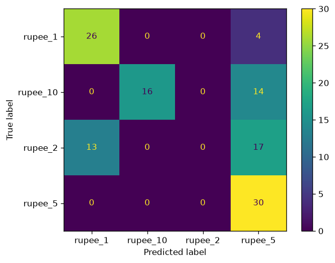
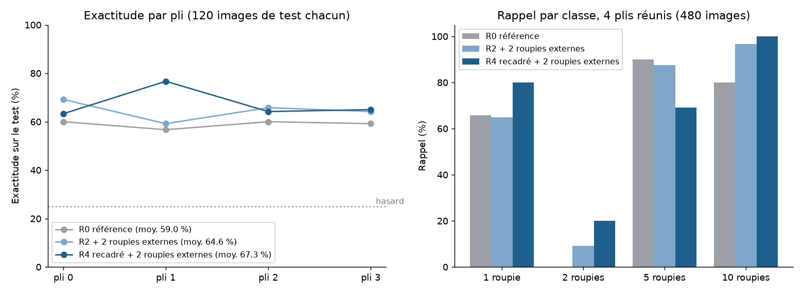

# Classification de pièces de monnaie par réseaux de neurones convolutifs

Projet de session du cours **MAP6014** (Université du Québec à Trois-Rivières, automne 2023), consacré aux applications du traitement et de l'analyse des données : reconnaissance de formes et apprentissage machine.

*English summary below.*

## En bref

L'objectif était de construire un système qui reconnaît la valeur d'une pièce de monnaie à partir d'une photo, puis de le rendre utilisable par une interface. Deux approches ont été comparées sur des images de pièces indiennes et brésiliennes :

- un **apprentissage par transfert avec VGG16** pré-entraîné sur ImageNet ;
- un **CNN séquentiel entraîné de zéro**, appelé « AUTOTUNE » dans le rapport.

Le CNN séquentiel atteint **98,1 % d'exactitude en test** sur le jeu « pièces indiennes + fausses pièces » (5 classes). Il a été déployé dans une interface **Streamlit** qui classe une image téléversée.

## Données

| Jeu de données | Images | Classes | Source |
|---|---|---|---|
| Indian coins | 656, portées à 778 par augmentation de la classe 10 roupies | 1, 2, 5, 10 roupies | Kaggle / IEEE DataPort |
| Indian coins + fake coins | 1 783 | 1, 2, 5 roupies, `invalid` (fausse pièce), `reverse` (revers) | Kaggle |
| Brazilian coins | 3 059 | 5, 10, 25, 50, 100 centavos | [Kaggle (lgmoneda/br-coins)](https://www.kaggle.com/lgmoneda/br-coins) |

Les images ne sont pas redistribuées ici (voir [`data/README.md`](data/README.md)).

## Démarche

1. **Exploration et augmentation** (`notebooks/01`). Les dimensions des images et l'effectif de chaque classe sont vérifiés. La classe 10 roupies, sous-représentée (74 images contre environ 194 pour les autres), est augmentée avec Albumentations : rotations, retournement horizontal, luminosité, contraste, teinte.
2. **VGG16 par transfert** (`notebooks/02`).
   - Partition : 70 % entraînement, 20 % validation, 10 % test.
   - Images en 224 × 224.
   - Base convolutive gelée, avec 14 714 688 paramètres non entraînables. Seule une couche de sortie de 100 356 paramètres est entraînée.
   - Adam, 20 époques, arrêt précoce sur le score F1.
3. **CNN séquentiel** (`notebooks/03` et `04`).
   - Images en 256 × 256, niveaux de gris.
   - Trois blocs Conv2D (32, 64, 128 filtres) avec MaxPooling, puis Dense(128) et Softmax : 16 871 173 paramètres.
   - Adam (ε = 0,01), 50 époques.
   - Partition : 70 % entraînement, 30 % partagés entre validation et test.
4. **Interface** (`app/`). Une application Streamlit charge les poids sauvegardés, reçoit une image et affiche la classe prédite.

Le code du CNN séquentiel (notebooks 03 et 04, `app/model_train.py`) est adapté d'un notebook public publié sur Kaggle, puis modifié pour ce projet : jeux de données, métriques, sauvegarde du modèle et interface.

## Résultats

| Modèle | Jeu de données | Exactitude (entraînement) | Exactitude (validation) | Exactitude (test) |
|---|---|---|---|---|
| CNN séquentiel | Indian coins + fake coins (5 classes) | 100 % | 98,9 % | **98,1 %** |
| CNN séquentiel | Indian coins (4 classes) | 80,2 % | 55,2 % | 56,3 % |
| VGG16 (transfert) | Indian coins (4 classes) | ≈ 86 % | 73,7 % | non mesurée : les 20,6 % du notebook ne sont pas valides (voir *Écarts relevés*) |
| VGG16, réexécution 2026 | ICDD, 4 classes, test sur des pièces jamais vues | 85 % | 61 % | **60 %** (voir *Réexécution de VGG16*) |
| VGG16 recadré + complément (2026) | ICDD, validation croisée par pièce, 4 plis | – | – | **67,3 %** (voir *Correction du biais des 2 roupies*) |

Valeurs lues dans les sorties des notebooks. Le rapport final indique que les résultats obtenus avec VGG16 sur les pièces brésiliennes sont comparables à ceux obtenus sur les pièces indiennes. Ces essais n'ont pas été conservés dans les notebooks.

<p align="center">
  
  
</p>

Les autres courbes sont dans [`results/figures/`](results/figures/) : VGG16 et CNN séquentiel sur les pièces indiennes.

## Réexécution de VGG16 (2026)

Les poids de VGG16 et le jeu de 656 images du notebook 02 n'ont pas été conservés, et le partage d'origine dépendait de l'ordre de lecture des fichiers sur Google Drive. Le score de test d'origine ne peut donc pas être recalculé. Le protocole a été réexécuté sur un jeu public proche, l'[Indian Coin Denomination Dataset (ICDD)](https://ieee-dataport.org/documents/indian-coin-denomination-dataset-icdd) (Chauhan et Singh, IEEE DataPort, 2021), avec l'évaluation corrigée.

**Données :**
- 780 photos des 4 classes du projet : 1, 2, 5 et 10 roupies ; les 20 roupies sont écartées.
- Les photos sont réduites à 448 pixels sur le plus grand côté ; le modèle les reçoit en 224 × 224, comme dans le notebook.
- **Partage par pièce physique** (script [`scripts/preparer_icdd.py`](scripts/preparer_icdd.py), graine 2026) : pour chaque classe, une pièce va au test, une à la validation et les autres à l'entraînement. Toutes les photos d'une même pièce restent dans le même ensemble.
- Cela donne 540 images d'entraînement, 120 de validation et 120 de test (30 par classe dans ces deux derniers ensembles).

**Protocole :** celui du notebook 02 (VGG16 gelé, Flatten, Dense(4), Adam 3e-4, 20 époques), avec un test non mélangé ([`scripts/vgg16_entrainement_evaluation.py`](scripts/vgg16_entrainement_evaluation.py)).

| Mesure | Valeur |
|---|---|
| Exactitude sur le test (pièces jamais vues) | **60,0 %** (exactitude équilibrée : 60,0 %) |
| Exactitude de validation | 60,9 % |
| Même modèle, évalué comme dans le notebook (test mélangé) | 23,3 % |

<p align="center"></p>

**Lecture :**
- **Le défaut d'évaluation est confirmé.** Évalué avec un test mélangé, le même modèle tombe à 23,3 %, au niveau du hasard pour 4 classes (25 %). Les 20,6 % du notebook relèvent donc de ce défaut, et non des performances du modèle.
- **Sur des pièces jamais vues, VGG16 gelé atteint 60 %.** Le modèle ne reconnaît jamais les 2 roupies : l'entraînement n'en compte que deux pièces (60 photos), contre sept pour les 5 roupies (210 photos), et le modèle penche vers cette classe majoritaire.
- **Le partage par pièce est plus exigeant** qu'un partage par photo, où des photos d'une même pièce peuvent se trouver de part et d'autre. Les chiffres ne sont donc pas comparables aux 73,7 % de validation du notebook, obtenus sur un autre jeu avec un partage par photo.
- **Limites :** une seule pièce par classe au test, un seul entraînement (graine 2000). Le score varierait avec d'autres pièces.

Fichiers : [`results/vgg16_reexecution_icdd/`](results/vgg16_reexecution_icdd/) (résultats, partage, journal d'entraînement, courbes). Les images de l'ICDD ne sont pas redistribuées.

## Correction du biais des 2 roupies (2026)

La réexécution ci-dessus ne reconnaît jamais les 2 roupies. Trois corrections ont été testées avec le même protocole, sur les mêmes images de test :

| Variante | Ce qui change à l'entraînement |
|---|---|
| R0 | rien (référence) |
| R1 | perte pondérée par l'inverse de la fréquence de chaque classe (`--poids-classes`) |
| R2 | + 350 images de 2 roupies tirées du jeu « Indian coins + fake coins » (`--complement`) |
| R3 | photos recadrées sur la pièce, 256 × 256 sur fond noir (`--recadrer`, [`scripts/recadrage.py`](scripts/recadrage.py)) |
| R4 | recadrage + 350 images de 2 roupies |

Les images ajoutées ne vont qu'à l'entraînement : la validation et le test restent 100 % ICDD. Elles viennent d'un autre domaine (gros plans sur fond noir, contre de petites pièces sur feuille blanche dans l'ICDD) ; le recadrage de R3 et R4 rapproche les deux domaines.

**Premier constat, sur le partage initial (120 images de test) :** aucune variante ne reconnaît les 2 roupies, sauf R4 (20 %). En regardant les pièces, la raison est apparue : les 4 pièces de 2 roupies de l'ICDD ont **4 dessins différents**, et la pièce de test (l'ancienne pièce à 11 côtés) a un dessin absent de l'entraînement comme du complément. Avec une seule pièce de test par classe, le score dépend donc surtout du tirage.

**Validation croisée par pièce (4 plis).** Chaque pli teste une autre pièce par classe (`--pli k`) ; chacune des 4 pièces de 2 roupies passe ainsi une fois au test. Les 4 plis réunis donnent 480 images de test, chacune testée une seule fois. Les variantes sont comparées à R0 par un test de McNemar exact apparié sur ces 480 images ([`scripts/validation_croisee.py`](scripts/validation_croisee.py)).

| Variante | Exactitude (4 plis réunis) | Pli le plus faible / le plus fort | Rappel 2 roupies | McNemar contre R0 |
|---|---|---|---|---|
| R0 référence | 59,0 % | 56,7 % / 60,0 % | 0 % | – |
| R2 + 2 roupies externes | 64,6 % | 59,2 % / 69,2 % | 9,2 % | p = 0,0001 (38 images corrigées, 11 perdues) |
| **R4 recadré + 2 roupies externes** | **67,3 %** | 63,3 % / 76,7 % | **20,0 %** | p = 0,001 (93 corrigées, 53 perdues) |

<p align="center"></p>

**Lecture :**
- **Les deux corrections améliorent le modèle de façon significative**, et sur chacun des 4 plis. R4 est la meilleure variante en moyenne, mais l'écart entre R4 et R2 n'est pas significatif (McNemar, p = 0,28).
- **La pondération des classes (R1) ne suffit pas** : 62,5 % contre 60 % sur le partage initial (p = 0,25), et toujours 0 % de rappel pour les 2 roupies. Donner plus de poids à deux pièces ne crée pas les dessins qui manquent.
- **Les gains ne sont pas gratuits.** R4 reconnaît mieux les 1, 2 et 10 roupies, mais moins bien les 5 roupies (69 % contre 90 %). Les 2 roupies restent la classe la plus difficile (20 %) : elles sont surtout confondues avec les 1 roupie, de couleur et de taille proches.
- **Le vrai remède serait plus de pièces**, et non plus de photos des mêmes pièces : chaque dessin de 2 roupies devrait être présent à l'entraînement.
- **Limites :** un seul entraînement par pli (graine 2000) ; 4 plis seulement, car la classe des 2 roupies n'a que 4 pièces ; pour les autres classes, toutes les pièces ne passent pas au test.

Fichiers : [`results/vgg16_variantes_2026/`](results/vgg16_variantes_2026/). Pour chaque variante et chaque pli : résultats, prédictions image par image (`predictions_test.csv`) et partage des pièces. Le complément de 2 roupies n'est pas redistribué (voir [`data/README.md`](data/README.md)).

Commandes (exemple pour R4, pli 2) :
```bash
python scripts/preparer_icdd.py icdd_reduit donnees_r4_pli2 --recadrer --complement indian_coins/2_rupee --pli 2
python scripts/vgg16_entrainement_evaluation.py donnees_r4_pli2 --sortie r4_pli2
python scripts/validation_croisee.py resume R0=r0_pli0,r0_pli1,r0_pli2,r0_pli3 R4=r4_pli0,r4_pli1,r4_pli2,r4_pli3
```

## Interface Streamlit

```bash
pip install -r requirements.txt
# Placer model.h5 (voir la section Releases du dépôt) dans app/
cd app
streamlit run app.py
```

Le guide d'utilisation est dans [`docs/guide_utilisation_interface.pdf`](docs/guide_utilisation_interface.pdf).

Depuis 2026, l'interface fonctionne avec les versions actuelles de TensorFlow (2.16 et suivantes) : la métrique F1 vient de Keras et non plus de `tensorflow-addons`, qui n'est plus maintenu. Le modèle est cherché à côté du script, et les images sont redimensionnées à 256 × 256 pixels. Testé avec TensorFlow 2.21 et le `model.h5` de la release.

Le fichier de poids `model.h5` (194 Mo) dépasse la taille admise pour un fichier ordinaire sur GitHub. Il est publié en pièce jointe d'une *Release*.

## Organisation du dépôt

```
notebooks/
├── 01_exploration_augmentation_indian_coins.ipynb   Dimensions, effectifs, augmentation de la classe 10 roupies
├── 02_vgg16_transfer_indian_coins.ipynb             Partition, VGG16 gelé, évaluation, prédiction
├── 03_cnn_sequentiel_indian_coins.ipynb             CNN séquentiel, pièces indiennes (4 classes)
└── 04_cnn_sequentiel_indian_fake_coins.ipynb        CNN séquentiel, pièces indiennes + fausses pièces (modèle déployé)
app/
├── app.py                                           Interface Streamlit
└── model_train.py                                   Reconstruction du modèle et prédiction
scripts/
├── preparer_icdd.py                                 Partage du jeu ICDD par pièce physique, plis, recadrage, complément (2026)
├── recadrage.py                                     Recadrage d'une photo sur la pièce (2026)
├── vgg16_entrainement_evaluation.py                 VGG16 avec évaluation corrigée, pondération des classes (2026)
├── comparer_variantes.py                            Variantes sur un même test, McNemar (2026)
├── validation_croisee.py                            Résumé de la validation croisée par pièce, McNemar (2026)
└── exporter_onnx.py                                 Export ONNX pour la démo dans le navigateur (2026)
docs/
├── rapport_final_MAP6014.pdf
├── presentation_finale_MAP6014.pdf
└── guide_utilisation_interface.pdf
results/figures/                                     Courbes d'apprentissage et matrice de confusion
data/README.md                                       Obtenir les jeux de données
```

Les notebooks sont présentés tels qu'ils ont été remis, avec leurs sorties d'exécution. Seuls leurs noms ont été changés pour indiquer l'ordre des étapes.

## Écarts relevés

Le projet est présenté tel qu'il a été remis. Une relecture du code a mis en évidence les points suivants, rapportés ici par transparence.

- **Évaluation de VGG16 sur le test.** Le générateur `test_set` est créé avec le mélange par défaut (`shuffle=True`). Les prédictions sont donc produites dans un ordre aléatoire, alors que les vraies étiquettes (`test_set.classes`) restent dans l'ordre des dossiers. La matrice de confusion et l'exactitude de 20,6 % comparent des étiquettes mal appariées et ne mesurent pas la performance réelle du modèle. L'exactitude de validation (73,7 %, obtenue avec `model.evaluate`) n'est pas concernée. **Correction (2026) :** le script [`scripts/vgg16_entrainement_evaluation.py`](scripts/vgg16_entrainement_evaluation.py) reprend le protocole avec un test non mélangé. Les poids et les images d'origine n'ayant pas été conservés, le protocole a été réexécuté sur le jeu public ICDD (voir *Réexécution de VGG16*) : 60 % sur des pièces jamais vues, contre 23,3 % pour le même modèle évalué avec un test mélangé, ce qui confirme le défaut.
- **Légende d'une figure.** La deuxième courbe de la cellule 40 du notebook 02 trace le rappel, mais sa légende indique « prec ». Corrigé dans le script de 2026.
- **Validation et test du CNN séquentiel.** Le jeu de test est obtenu en prenant la moitié des lots d'un jeu de validation mélangé (`shuffle=True`, puis `take`/`skip`). Avec `tf.data`, ce mélange est refait à chaque parcours, de sorte que les images de validation et de test peuvent se recouvrir d'une époque à l'autre.
- **Augmentation avant la partition.** Les images augmentées de la classe 10 roupies sont enregistrées dans le même dossier que les originales, avant la partition. Une image et ses versions augmentées peuvent donc se retrouver dans des ensembles différents, ce qui peut rendre la validation et le test optimistes pour cette classe.
- **Nom du modèle.** « AUTOTUNE » désigne dans le rapport le CNN séquentiel. Il s'agit en fait de la constante `tf.data.AUTOTUNE`, utilisée dans le notebook pour le préchargement des données, et non d'une architecture.
- **Comparaison avec la littérature.** Le rapport compare les 98 % du CNN séquentiel aux résultats de l'article de référence, obtenus sur les pièces brésiliennes. Les deux chiffres portent sur des jeux de données différents.
- **Interface.** Le modèle est reconstruit et ses poids rechargés à chaque prédiction. La classe `Predict` d'`app.py` n'est pas utilisée. Dans la version remise, l'interface dépendait de `tensorflow-addons`, qui n'est plus maintenu, et nécessitait TensorFlow 2.15 au plus ; elle cherchait aussi le modèle dans le dossier courant et ne redimensionnait pas les images. Corrigé en 2026 (voir *Interface Streamlit*).

## Compétences mises en œuvre

Python · TensorFlow/Keras · apprentissage par transfert (VGG16) · CNN · augmentation de données (Albumentations) · scikit-learn · Streamlit · Google Colab

## Auteure

**Mireille Kafando**, M. Sc. en mathématiques et informatique appliquées (génie logiciel), UQTR

Projet réalisé dans le cadre du cours MAP6014, sous la supervision du professeur François Meunier.

---

## English summary

Course project for **MAP6014** (Université du Québec à Trois-Rivières, Fall 2023; theme: pattern recognition and machine learning): image-based coin classification with convolutional neural networks.

- **Approach:** transfer learning with a frozen **VGG16** backbone (100,356 trainable parameters) versus a **sequential CNN trained from scratch** (3 Conv2D blocks, 16.9M parameters, called "AUTOTUNE" in the report), on Indian and Brazilian coin images. Class imbalance was handled with Albumentations data augmentation.
- **Results:** the sequential CNN reaches **98.1% test accuracy** on the 5-class *Indian coins + fake coins* dataset (1,783 images), and 56.3% on the 4-class *Indian coins* dataset. VGG16 reaches 73.7% validation accuracy on *Indian coins*.
- **Credit:** the sequential CNN code is adapted from a public Kaggle notebook.
- **Deployment:** a **Streamlit** app loads the trained model and classifies an uploaded image. The 194 MB weight file is published as a GitHub Release asset. Since 2026 the app runs on current TensorFlow (2.16+): the unmaintained `tensorflow-addons` dependency was replaced by Keras' F1 metric.
- **Known issues:** the project is shown as submitted. A post-hoc code review found some issues: the VGG16 test evaluation used a shuffled generator, so its confusion matrix and 20.6% test accuracy compare misaligned labels. The validation and test splits of the sequential CNN may overlap. The 10-rupee augmentation was done before splitting. They are listed in *Écarts relevés*. In 2026 the VGG16 protocol was re-run with a corrected evaluation on the public ICDD dataset (4 classes, split by physical coin): **60% test accuracy on unseen coins**, versus 23.3% for the same model evaluated with the notebook's shuffled test set, which confirms the original 20.6% was an evaluation artefact. The re-run never recognised 2-rupee coins: the 4 two-rupee coins of ICDD have 4 different designs, and the test coin's design is absent from training. Adding 350 external 2-rupee images (training only) and cropping photos to the coin raised **coin-wise 4-fold cross-validated accuracy from 59.0% to 67.3%** (exact McNemar test on 480 paired test images, p = 0.001), with 2-rupee recall from 0% to 20%.

Datasets are not redistributed; see `data/README.md`.
