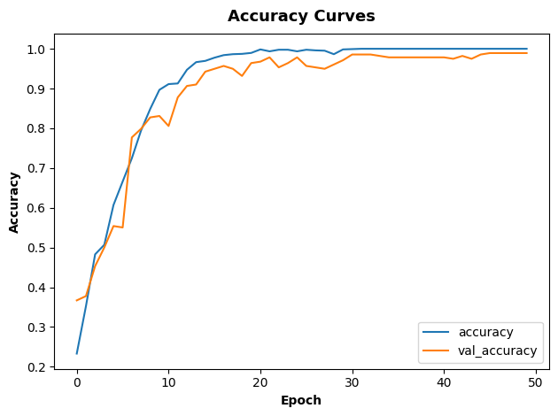
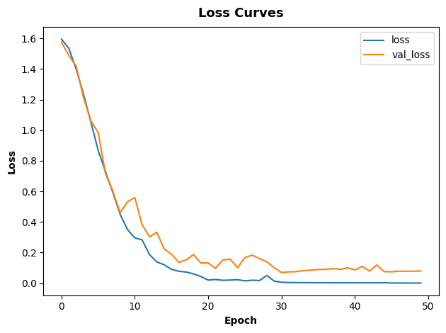

# Classification de pièces de monnaie par réseaux de neurones convolutifs

Projet de session du cours **MAP6014** (Université du Québec à Trois-Rivières, automne 2023), consacré aux applications du traitement et de l'analyse des données : reconnaissance de formes et apprentissage machine.

*English summary below.*

## En bref

L'objectif était de construire un système qui reconnaît la valeur d'une pièce de monnaie à partir d'une photo, puis de le rendre utilisable par une interface. Deux approches ont été comparées sur des images de pièces indiennes et brésiliennes :

- un **apprentissage par transfert avec VGG16** pré-entraîné sur ImageNet ;
- un **CNN séquentiel entraîné de zéro**, appelé « AUTOTUNE » dans le rapport.

Le CNN séquentiel atteint **98,1 % d'exactitude en test** sur le jeu « pièces indiennes + fausses pièces » (5 classes). Il a été déployé dans une interface **Streamlit** qui classe une image téléversée.

## Données

| Jeu de données | Images | Classes | Source |
|---|---|---|---|
| Indian coins | 656, portées à 778 par augmentation de la classe 10 roupies | 1, 2, 5, 10 roupies | Kaggle / IEEE DataPort |
| Indian coins + fake coins | 1 783 | 1, 2, 5 roupies, `invalid` (fausse pièce), `reverse` (revers) | Kaggle |
| Brazilian coins | 3 059 | 5, 10, 25, 50, 100 centavos | [Kaggle (lgmoneda/br-coins)](https://www.kaggle.com/lgmoneda/br-coins) |

Les images ne sont pas redistribuées ici (voir [`data/README.md`](data/README.md)).

## Démarche

1. **Exploration et augmentation** (`notebooks/01`). Les dimensions des images et l'effectif de chaque classe sont vérifiés. La classe 10 roupies, sous-représentée (74 images contre environ 194 pour les autres), est augmentée avec Albumentations : rotations, retournement horizontal, luminosité, contraste, teinte.
2. **VGG16 par transfert** (`notebooks/02`).
   - Partition : 70 % entraînement, 20 % validation, 10 % test.
   - Images en 224 × 224.
   - Base convolutive gelée, avec 14 714 688 paramètres non entraînables. Seule une couche de sortie de 100 356 paramètres est entraînée.
   - Adam, 20 époques, arrêt précoce sur le score F1.
3. **CNN séquentiel** (`notebooks/03` et `04`).
   - Images en 256 × 256, niveaux de gris.
   - Trois blocs Conv2D (32, 64, 128 filtres) avec MaxPooling, puis Dense(128) et Softmax : 16 871 173 paramètres.
   - Adam (ε = 0,01), 50 époques.
   - Partition : 70 % entraînement, 30 % partagés entre validation et test.
4. **Interface** (`app/`). Une application Streamlit charge les poids sauvegardés, reçoit une image et affiche la classe prédite.

## Résultats

| Modèle | Jeu de données | Exactitude (entraînement) | Exactitude (validation) | Exactitude (test) |
|---|---|---|---|---|
| CNN séquentiel | Indian coins + fake coins (5 classes) | 100 % | 98,9 % | **98,1 %** |
| CNN séquentiel | Indian coins (4 classes) | 80,2 % | 55,2 % | 56,3 % |
| VGG16 (transfert) | Indian coins (4 classes) | ≈ 86 % | 73,7 % | 20,6 % (voir *Écarts relevés*) |

Valeurs lues dans les sorties des notebooks. Le rapport final indique que les résultats obtenus avec VGG16 sur les pièces brésiliennes sont comparables à ceux obtenus sur les pièces indiennes. Ces essais n'ont pas été conservés dans les notebooks.

<p align="center">
  
  
</p>

Les autres courbes sont dans [`results/figures/`](results/figures/) : VGG16 et CNN séquentiel sur les pièces indiennes.

## Interface Streamlit

```bash
pip install -r requirements.txt
# Placer model.h5 (voir la section Releases du dépôt) dans app/
cd app
streamlit run app.py
```

Le guide d'utilisation est dans [`docs/guide_utilisation_interface.pdf`](docs/guide_utilisation_interface.pdf).

Le fichier de poids `model.h5` (194 Mo) dépasse la taille admise pour un fichier ordinaire sur GitHub. Il est publié en pièce jointe d'une *Release*.

## Organisation du dépôt

```
notebooks/
├── 01_exploration_augmentation_indian_coins.ipynb   Dimensions, effectifs, augmentation de la classe 10 roupies
├── 02_vgg16_transfer_indian_coins.ipynb             Partition, VGG16 gelé, évaluation, prédiction
├── 03_cnn_sequentiel_indian_coins.ipynb             CNN séquentiel, pièces indiennes (4 classes)
└── 04_cnn_sequentiel_indian_fake_coins.ipynb        CNN séquentiel, pièces indiennes + fausses pièces (modèle déployé)
app/
├── app.py                                           Interface Streamlit
└── model_train.py                                   Reconstruction du modèle et prédiction
docs/
├── rapport_final_MAP6014.pdf
├── presentation_finale_MAP6014.pdf
└── guide_utilisation_interface.pdf
results/figures/                                     Courbes d'apprentissage et matrice de confusion
data/README.md                                       Obtenir les jeux de données
```

Les notebooks sont présentés tels qu'ils ont été remis, avec leurs sorties d'exécution. Seuls leurs noms ont été changés pour indiquer l'ordre des étapes.

## Écarts relevés

Le projet est présenté tel qu'il a été remis. Une relecture du code a mis en évidence les points suivants, rapportés ici par transparence.

- **Évaluation de VGG16 sur le test.** Le générateur `test_set` est créé avec le mélange par défaut (`shuffle=True`). Les prédictions sont donc produites dans un ordre aléatoire, alors que les vraies étiquettes (`test_set.classes`) restent dans l'ordre des dossiers. La matrice de confusion et l'exactitude de 20,6 % comparent des étiquettes mal appariées et ne mesurent pas la performance réelle du modèle. L'exactitude de validation (73,7 %, obtenue avec `model.evaluate`) n'est pas concernée.
- **Légende d'une figure.** La deuxième courbe de la cellule 40 du notebook 02 trace le rappel, mais sa légende indique « prec ».
- **Validation et test du CNN séquentiel.** Le jeu de test est obtenu en prenant la moitié des lots d'un jeu de validation mélangé (`shuffle=True`, puis `take`/`skip`). Avec `tf.data`, ce mélange est refait à chaque parcours, de sorte que les images de validation et de test peuvent se recouvrir d'une époque à l'autre.
- **Augmentation avant la partition.** Les images augmentées de la classe 10 roupies sont enregistrées dans le même dossier que les originales, avant la partition. Une image et ses versions augmentées peuvent donc se retrouver dans des ensembles différents, ce qui peut rendre la validation et le test optimistes pour cette classe.
- **Nom du modèle.** « AUTOTUNE » désigne dans le rapport le CNN séquentiel. Il s'agit en fait de la constante `tf.data.AUTOTUNE`, utilisée dans le notebook pour le préchargement des données, et non d'une architecture.
- **Comparaison avec la littérature.** Le rapport compare les 98 % du CNN séquentiel aux résultats de l'article de référence, obtenus sur les pièces brésiliennes. Les deux chiffres portent sur des jeux de données différents.
- **Interface.** Le modèle est reconstruit et ses poids rechargés à chaque prédiction. La classe `Predict` d'`app.py` n'est pas utilisée. L'interface dépend de `tensorflow-addons`, qui n'est plus maintenu : elle nécessite TensorFlow 2.15 au plus.

## Compétences mises en œuvre

Python · TensorFlow/Keras · apprentissage par transfert (VGG16) · CNN · augmentation de données (Albumentations) · scikit-learn · Streamlit · Google Colab

## Auteure

**Mireille Kafando**, M. Sc. en mathématiques et informatique appliquées (génie logiciel), UQTR

Projet réalisé dans le cadre du cours MAP6014, sous la supervision du professeur François Meunier.

---

## English summary

Course project for **MAP6014** (Université du Québec à Trois-Rivières, Fall 2023; theme: pattern recognition and machine learning): image-based coin classification with convolutional neural networks.

- **Approach:** transfer learning with a frozen **VGG16** backbone (100,356 trainable parameters) versus a **sequential CNN trained from scratch** (3 Conv2D blocks, 16.9M parameters, called "AUTOTUNE" in the report), on Indian and Brazilian coin images. Class imbalance was handled with Albumentations data augmentation.
- **Results:** the sequential CNN reaches **98.1% test accuracy** on the 5-class *Indian coins + fake coins* dataset (1,783 images), and 56.3% on the 4-class *Indian coins* dataset. VGG16 reaches 73.7% validation accuracy on *Indian coins*.
- **Deployment:** a **Streamlit** app loads the trained model and classifies an uploaded image. The 194 MB weight file is published as a GitHub Release asset.
- **Known issues:** the project is shown as submitted. A post-hoc code review found some issues: the VGG16 test evaluation used a shuffled generator, so its confusion matrix and 20.6% test accuracy compare misaligned labels. The validation and test splits of the sequential CNN may overlap. The 10-rupee augmentation was done before splitting. They are listed in *Écarts relevés*.

Datasets are not redistributed; see `data/README.md`.
